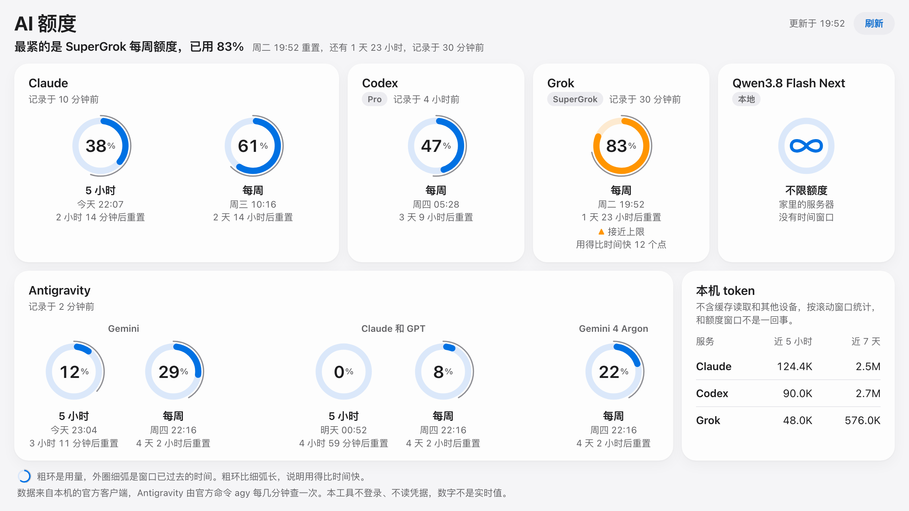

# ai-quota

在一页里看 Claude、Codex、Grok 和 Antigravity 的订阅额度还剩多少。只读官方客户端已经写在本机的数据：不登录，不读凭据文件，自己也不调用任何服务商接口。

A local dashboard for AI subscription quotas (Claude Code, Codex, Grok Build, Antigravity). It only reads what the official clients already write on your machine. It never signs in, never reads credential files, and never calls a provider API itself. Python 3.9+, standard library only. The UI is in Chinese.

<picture>
  <source media="(prefers-color-scheme: dark)" srcset="docs/screenshot-dark.png">
  
</picture>

截图用的是示例数据。

## 为什么要做这个

很多额度工具要你登录账号，或者读取客户端保存的登录凭据去替你查询。几家服务商的条款都不允许把订阅账号交给第三方工具使用。这个工具换了一条路：官方客户端在正常使用时本来就会把额度写进本机日志，或者提供只读的查询命令，ai-quota 只读这些。

## 安装

需要 Python 3.9 或更新版本，不用装任何依赖。主要在 macOS 上用过。

```bash
git clone https://github.com/lij768423-svg/ai-quota.git
cd ai-quota
mkdir -p ~/.local/bin
ln -s "$PWD/ai_quota.py" ~/.local/bin/ai-quota
```

`~/.local/bin` 要在 `PATH` 里。

### 让 Claude Code 写入额度

Claude Code 不会把额度写进日志，只在终端界面刷新状态栏时把它传给 `statusLine` 命令。在 `~/.claude/settings.json` 里加上：

```json
{
  "statusLine": {
    "type": "command",
    "command": "ai-quota statusline"
  }
}
```

之后状态栏会显示 `5h 24% · 7d 41%` 这样的额度，ai-quota 同时把数字存到 `~/.local/state/ai-quota/claude.json`。

- 状态栏的命令找不到 `ai-quota` 时，把 `command` 换成绝对路径，比如 `/Users/你的用户名/.local/bin/ai-quota statusline`。
- `statusLine` 只能配一个。你已经有自己的状态栏的话，需要自己合并。
- 只有终端里的 Claude Code 会触发状态栏，桌面应用不会。

## 用法

打开网页界面：

```bash
ai-quota ui
```

在终端里看：

```bash
ai-quota
```

输出 JSON：

```bash
ai-quota --json
```

## 网页界面

- 只监听 `127.0.0.1:18765`，只接受本机 Host。页面不加载任何外部资源，也不能向其他地址发请求。
- 页面每分钟刷新一次。关掉页面后，服务闲置 10 分钟自动退出，下次运行 `ai-quota ui` 会重新启动。
- 每个额度是一个圆环：粗环是用量，外圈细弧是窗口已过去的时间。粗环比细弧长，说明用得比时间快。用到 80% 和 95% 时圆环变色，并配图标和文字。
- 1280×720 以上的窗口一屏放完，不用滚动。窗口再小时整页等比缩小，最多缩到 80%；手机宽度放不下，就正常滚动。
- 跟随系统的浅色和深色模式。系统开了“减少动态效果”时，圆环不播放进场动画。

## 数据来源

| 服务 | 额度百分比 | 套餐标识 | token |
|---|---|---|---|
| Claude | 官方 `statusLine` 传给 `ai-quota statusline` 的 `rate_limits`，存在 `~/.local/state/ai-quota/claude.json` | 官方命令 `claude auth status`，只保留 `subscriptionType` | `~/.claude/projects` 日志 |
| Codex | `~/.codex/sessions` 日志里的 `rate_limits` | 同一份日志里最新的 `plan_type` | 同一份日志 |
| Grok | `~/.grok/logs/unified.jsonl` 里的 `creditUsagePercent`，登录 Grok Build 后才有 | 同一份日志 | `~/.grok/sessions/*/*/updates.jsonl` |
| Antigravity | 官方命令 `agy -p /usage --output-format json`，结果存在 `~/.local/state/ai-quota/antigravity.json` | 桌面应用日志 `~/Library/Logs/Antigravity/language_server.log`，有值时才显示 | 没有 |

Codex 换套餐后，日志里的窗口也会变（比如 Pro 只有每周额度）。这里只显示最新套餐的窗口，旧套餐的数字不混进来。`prolite` 是每月 100 美元那一档，按 Codex 自己的叫法显示成 Pro。

Antigravity 的 `/usage` 在 print 模式下不开对话、不花额度、不留会话记录，agy 的更新说明里写明了这一点。ai-quota 只运行这个命令、读它的输出，不碰它的登录信息，也不直接请求它的服务。保存时只留模型组名、用量百分比和时间，不存账号。平时 5 分钟最多查一次；点网页上的“刷新”或在终端运行 `ai-quota` 时是 1 分钟。查询失败后也等同样的时间再试。

token 不含缓存读取，只统计这台电脑，也不区分走官方还是走自建网关。近 5 小时和近 7 天都是滚动窗口，和官方额度窗口不是一回事。

## 本地模型

自己部署的模型没有额度，可以在页面上显示成一个带 ∞ 的圆环。在 `~/.config/ai-quota/config.json` 里写：

```json
{
  "local_models": [
    {"name": "Qwen3.8 Flash Next", "detail": "家里的服务器"}
  ]
}
```

`detail` 可以不写。ai-quota 不会去连这些模型的服务器。

## 限制

- 数字只在官方客户端写入时更新，不是实时值。看“记录于”判断新旧，过了重置时间显示“已重置”。
- Claude 的额度只有终端里的 Claude Code 会写入，桌面应用不会。
- Grok 的额度在 Grok Build 启动时写入，用到一半不会更新。
- Antigravity 还没用过的窗口，重置时间是查询时刻加上窗口长度，每次查询都会往后推，开始用之后才固定。
- 在终端运行 `ai-quota` 时，如果距上次查 Antigravity 超过 1 分钟，会多等 3 秒左右。
- 同一窗口内取见过的最大值，因为并发会话可能写入旧数字。服务商中途重置额度但重置时间没变时，数字会偏高。
- 这些日志格式都没有稳定性承诺，客户端更新后可能要跟着改。

## 卸载

1. 删掉 `~/.local/bin/ai-quota` 这个链接。
2. 从 `~/.claude/settings.json` 里删掉 `statusLine`。
3. 删掉 `~/.local/state/ai-quota` 和 `~/.config/ai-quota`。

## 测试

```bash
python3 -m unittest test_ai_quota
```

## 说明

本项目和 Anthropic、OpenAI、xAI、Google 都没有关系。产品名只用来说明读的是哪个客户端的数据。

## 许可证

[MIT](LICENSE)
